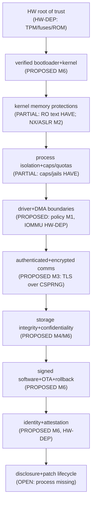

# Darwin-Inspired Architecture, Hardware Portability & Kernel Strategy Review

Architecture review and documentation ONLY. No
implementation, no refactor, no milestone started.
Baseline preserved: HEAD `0b5da64` (v0.5 Phase L
`59ea07b` + fbcon console + CLI manual, both
authorized); tree holds the previous audit's
uncommitted docs + 14 proposed ADRs, all preserved
and none ratified here.

## 1. Objective and scope

Question: what architectural properties let an OS
move from infrastructure/IoT into general-purpose
computing across hardware — and which of them
should NOVA adopt, in what order, at what cost?
Reference systems: Darwin/XNU (primary, checked
against Apple's archived Kernel Programming Guide
and IOKit Fundamentals), Linux (driver model and
ecosystem lessons, general knowledge), others
where a mechanism is illustrative. Nothing here
authorizes copying code: Darwin/XNU sources carry
the APSL, whose copyleft-style filing and patent
terms must be reviewed per-component before ANY
reuse; IOKit concepts are adopted as principles,
re-implemented in NOVA's freestanding C.

## 2. Property-by-property assessment

For each property: HAVE (in-tree, gated) /
DOC (documented/proposed only) / GAP (absent).

| Property | v0.5 state | Change class | Evidence of done |
| arch-independent vs CPU-specific split | GAP (ports + asm inline in subsystem files) | incremental: extract behind `arch_*` | portability lint + two-backend build |
| Stable HAL (irq/timer/mmio/clock) | GAP (PIC/PIT hard-coded) | incremental: new layer, x86 backend first | same serial bytes, stub backend |
| Structured driver model | GAP (pm_main calls drivers) | incremental: lifecycle + registry, then matching | probe/remove/replace tests |
| Device discovery + resource ownership | GAP (fixed VBox layout) | incremental: PCI enumerator first | two NICs / two disks, no conflicts |
| Explicit kernel/userspace split | HAVE (rings, INT 0x80, validate-all) | keep + extend (mmap/IPC next) | T8-style vectors per new call |
| Process + IPC contracts | DOC (spawn/exec exist; no pipes/shm/signals) | incremental: one primitive at a time | waiter-matrix-grade proofs |
| Designed (not retrofitted) SMP | GAP (APs parked) | redesign of sync core (M2, fenced) | contention proofs at 2+ CPUs |
| Memory protection + DMA isolation | PARTIAL (RO text, U/S; no NX/IOMMU) | incremental per feature | permission-grid audits |
| Portable net/storage interfaces | PARTIAL (socket API; no block iface) | incremental: NIC + block abstractions | second backend each |
| Power-management abstractions | GAP (hlt-idle only) | incremental: states as policy + hooks | state-transition tests |
| Portable build/test infra | HAVE (one driver, VBox gates) | extend per platform (HW rig at M5) | per-arch gate runs |
| Stable app-facing ABI | DOC (38 calls stable in practice, promised to nothing) | policy first (freeze + versions) | compat corpus green |
| Composable trust chain | DOC (threat model; no boot/crypto/OTA) | staged M2→M6, HW-gated | hostile-update ten green |
| Embedded-to-capable scaling | GAP (one 1 MB image profile) | config profiles, not forks | two profiles from one tree |

Abstraction alone guarantees nothing: every row
above is perf-tested, adversarially tested, and
regression-gated, or it is a claim, not a property.

## 3. Lessons from Darwin/XNU

Sources checked for this review: Apple's archived
*Kernel Programming Guide: Kernel Architecture
Overview* and *IOKit Fundamentals: Introduction*
(both retrieved 2026; Apple docs archive). XNU
internals below beyond those two documents are
general published knowledge — re-verify from
opensource.apple.com before detailed design.

L1. The "kernel" is a kernel ENVIRONMENT, not a
microkernel. Apple's own guide stresses this:
Mach + BSD + IOKit + FS + networking ship as one
"kernel," with three APIs for some operations.
Lesson for NOVA: stop debating labels; define
ENVIRONMENTS (what runs privileged, under which
contract) instead. NOVA's v0.5 tree already is a
kernel environment — name it, contract it.

L2. Personalities separate mechanism from policy.
Mach owns scheduling/VM/IPC primitives; the BSD
layer owns the process model, signals, POSIX, and
sockets. The split survived 25 years across PPC,
x86, ARM64 — proof that a thin mechanism layer
beneath a replaceable personality is the
portability engine. Lesson: NOVA's sched/mm/IF-
discipline core is its "Mach"; its syscall table
is its "personality." Grow them on different
schedules with a seam between (proposed ADR:
kuu-service-boundaries covers the seam test).

L3. IOKit: registry + matching + families + work
loops + power, in restricted C++. The durable
ideas are not the language: (a) a live device
tree (I/O Registry) instead of probe-order luck;
(b) declarative driver matching (score, not
first-come); (c) family base classes (one USB/
one PCI contract, many drivers); (d) work loops
(single-threaded event discipline per driver —
NOVA's IF-held sections are the same idea without
the framework); (e) power as a first-class driver
contract. Costs Apple paid: C++ in kernel
(tooling, exceptions banned, static analysis
burden), KEXT security crises (solved by
notarization, then by pushing drivers OUT to
DriverKit dexts). Lesson: adopt a–e as C patterns
behind NOVA's driver framework; do NOT adopt
kernel C++, KEXT-style loadable modules, or
Apple's class hierarchy. And learn the ending:
Apple's direction of travel is drivers OUT of the
kernel — NOVA's M2/M4 policy-first path already
points that way.

L4. Platform differences live in platform EXPERTS
and KPI, not in #ifdefs scattered through
subsystems. Apple Silicon arrived fast because
interrupts/timers/clocks/power were behind
interfaces with per-platform implementations.
Lesson: NOVA's M1 abstraction milestone is the
same bet at smaller scale; the portability test
(§5) is its acceptance proof.

L5. Compatibility is a LAYER, not a goal. BSD
carried POSIX while Mach stayed alien; Rosetta
carried binaries across ISAs. Lesson: NOVA's
POSIX-subset profile and (later) Linux-ABI
assessment are layers above a frozen native ABI
— never modifications of it.

L6. What NOT to copy: three overlapping APIs for
one operation (confuses every review); KEXTs as a
distribution model (proved unsecurable at scale);
Objective-C/C++ runtime in kernel; entitlement
sprawl as a substitute for small TCB; assuming
Apple's vertical integration (one vendor, few
boards) transfers to NOVA's open-hardware world —
it does not, so NOVA needs explicit board policy
where Apple needs none.

## 4. Four kernel architectures compared

Dimensions scored H/M/L (judgment, labeled).

| Dimension | A monolithic | B modular mono | C hybrid | D microkernel |
| Performance (IPC-light paths) | H | H | M-H | M (IPC tax) |
| Fault isolation | L | M (boundaries) | M | H |
| Security boundaries | L | M | M | H (if servers small) |
| Driver reliability | L | M | M | H |
| IPC complexity | L (n/a) | L | M | H (the OS becomes IPC) |
| Multicore scaling | M | M-H | M-H | M-H (servers must scale too) |
| Real-time fit | M-H | H (bounded domains) | H | M (jitter via servers) |
| Debugging/diagnostics | H | H | M | M (distributed traces) |
| HW portability | M | H | H | H |
| Implementation cost | L | M | H | H |
| NOVA codebase fit | H (is today) | H (evolution) | M | L (rewrite) |
| Incremental migration | n/a | H | M | L |
| Test-corpus risk | none | LOW (additive) | MED (re-audit) | HIGH (discard) |
| Infra/IoT fit | M | H | H | M (footprint + IPC) |
| General-purpose fit | H | H | H | M-H |

No simplistic verdicts: microkernels are not
automatically safer (a 200 kLOC "server" is a
kernel with extra steps), monoliths are not
automatically faster (a contended big lock loses
to message-passing). Mechanisms and sizes decide.

RECOMMENDATION: B — modular monolithic evolution.
This REFINES (not reverses) the previous audit's
retain-the-monolith: keep one privilege domain
and the entire proof corpus, but introduce
explicit, testable subsystem boundaries in a
fixed order — arch/platform/driver seams first
(M1), memory/IPC/service seams next (M2), driver
framework with lifecycle + matching (M4), and
user-space services only for new crash-safe code
(update agent, telemetry) where the IPC cost is
measured, never assumed. Answers to the seven
mandatory questions: (1) yes, retain the
foundation; (2) yes, evolve it toward B; (3) move
only NEW services out, never existing proven
subsystems without a fault-injection case;
(4) no hybrid/microkernel transition — no
requirement names one, and the corpus cost is
concrete while the benefits are hypothetical;
(5) first boundaries: arch_* extraction, HAL,
driver lifecycle/registry; (6) too immature to
stabilize now: scheduler policy interface (RT
analysis pending), VFS op granularity (SMP data
pending), driver ABI of any kind; (7) revisit
only on: a certification demanding isolation, a
fault-injection study showing boundary value, or
a product requiring third-party drivers. A
reassessment note is appended to proposed ADR
kernel-architecture (still unratified).

## 5. Hardware portability architecture

Layers (refinement of the brief's sketch; NOVA
paths in parentheses):

- Portable Kernel Core (kernel/sched, thread,
  process, mm interfaces, fs/, net/, sync/,
  trace/, syscall/ dispatch): NO port I/O, NO
  inline asm, NO fixed pointer width, NO
  x86-segment assumptions. Owner: core
  maintainers. Contract: compiles against
  `arch_*` + `plat_*` headers only (linted).
- Architecture Abstraction (`kernel/arch/<isa>/`):
  cpu/atomics, MMU/pagetables, exception entry,
  ctx switch, barriers, early boot. Contract:
  per-function semantics incl. barrier strength
  and interrupt-entry guarantees (ARM's weaker
  ordering must be documented per function, not
  assumed x86-strong).
- Platform Abstraction (`kernel/plat/<board>/` +
  `boot/` producers): interrupt controller,
  timers/clocks, firmware iface (BIOS/UEFI/DT),
  memory map, PCI/PCIe enum, power states. Init
  order: firmware struct → plat map → arch early
  → pmm → irq/timer → drivers. Drivers NEVER
  touch plat directly; they consume handles.
- Driver Framework (`kernel/drv/` + families):
  lifecycle (probe/start/stop/remove), registry
  (live tree, IOKit-inspired, C implementation),
  declarative matching (score tables), resource
  ownership (MMIO/ports/IRQ/DMA handles with
  release), DMA map/unmap + teardown, interrupt
  registration with context rules (no sleep, no
  alloc — today's ISR rules, kept), deferred
  work (work-loop pattern: single-threaded event
  discipline per driver), power transitions,
  reset/recovery, explicit unloadable-or-not
  decision per driver (default: NOT unloadable
  until M7 says otherwise with tests).
- Supported Platforms (`plat/` manifests): x86-32
  VBox (validation), x86-64 (first product arch),
  ARM64 board (second), RISC-V (portability
  milestone, not a product promise).

Per-boundary contract fields (all five layers):
owner, API, init order, error returns, lifetime,
concurrency (incl. IRQ-context bans), DMA/memory
assumptions, host-testability (stub backend
required — generalize today's NOVA_TEST_STUB),
arch-specific behavior deltas (documented, never
silent), migration path for existing callers.

PORTABILITY TEST (future gate, M1 exit): declared
portable/arch/platform file lists (generated by
lint, committed); zero `inb/outb/lidt/cli` outside
arch/ (grep gate); x86 build boots with identical
serial bytes; stub-backend host build passes unit
corpus; documented deltas list non-empty where
hardware differs (empty means lying, not portable).

## 6. Multi-architecture strategy

| Axis | x86-32 (today) | x86-64 (first) | ARM64 (next) | RISC-V (later) |
| Boot | BIOS stage1 | long mode, own loader step | EL2→EL1, DT/UEFI | SBI/OpenSBI, DT |
| MMU | 2-level, U/S | 4-level, NX/XD, PCID | 4-level, ASID, PXN/UXN | Sv39/48, DT memory |
| Interrupts | 8259 PIC, INT 0x80 | IDT + LAPIC + syscall insn | GICv3/4, SVC + EL model | PLIC/CLINT, ecall |
| Timers | PIT 100 Hz | LAPIC/HPET/TSC-deadline | generic timer + CNTFRQ | SBI time |
| Ordering | TSO-strong | TSO-strong | WEAK (barriers per fn) | WEAK (fences) |
| SMP | APs parked | bring-up + shootdown | PSCI + spin-table | SBI HSM |
| DMA/IOMMU | none | VT-d where present | SMMU where present | IOPMP (varies) |
| FW | BIOS | UEFI | UEFI + DT | DT + SBI |
| Toolchain | mingw -m32 (HAVE) | -m64 + multiboot/own | aarch64-none-elf + DT blobs | riscv64 + SBI |
| First HW | VBox (HAVE) | x86-64 mini-PC/NUC-class | ONE named SBC | QEMU-virt only |
| Cost | sunk | LOW (closest to today) | HIGH (new everything) | MED (strip-down port) |

Recommendation: FIRST production architecture
x86-64 (reuses VBox rig knowledge, PCI/virtio
drivers, toolchain; unblocks NX/SMAP/PCID/IOMMU
that 32-bit cannot carry). NEXT ARM64 (market
access; needs GIC/timer/DT/platform-expert work
+ one named board). x86-32 becomes validation-
only with named end-of-support (keeps the cheap
deterministic CI). RISC-V is a portability
milestone on QEMU-virt (proves the abstractions
honest) — never promise product support before
the ecosystem (SBI firmware, IOMMU story) exists.

Dependency graph (extension of ROADMAP §6):
`M1-abstractions → x86-64 bring-up → NX/SMAP/
IOMMU → SMP-re-audit → ARM64-GIC/timers → board
drivers → radios`. x86-64 and ARM64 userlands
share the frozen native ABI (endianness: LE
assumed everywhere — recorded porting note).

## 7. Driver and device framework

From pm_main-calls-drivers to a framework, in
three stages (smallest-first per the brief):

Stage 1 — lifecycle + ownership (M1/M4, no new
HW needed): every driver gets probe/start/stop/
remove with ordered init, consumes IRQ/DMA/MMIO
as handles (never raw ports outside arch/plat),
DMA descriptors validated like virtio rings
already are. Acceptance: unload-order test,
double-probe test, handle-leak test.

Stage 2 — registry + matching (M4, with second
device): live device tree + score-table matching
(IOKit lessons a–b); one family contract per
class (net/block/input) so the second NIC/disk
needs no core changes. Acceptance: two instances,
conflict-free resources, wrong-driver-refused.

Stage 3 — power + recovery (M5, with real HW):
per-driver power states, reset/recovery paths,
hang detection (watchdog). Acceptance: suspend/
resume cycle tests, surprise-removal tests.

Linux lessons to steal: bus+class+device
separation, sysfs-like introspection (via NOVA's
diagnostics contract, not a new filesystem),
devres-style managed resources. Linux costs to
refuse: 10,000-driver maintenance culture, Kconfig
combinatorics, stable-API-nonsense debates —
NOVA stays small by board policy (one board per
milestone). DriverKit's lesson (drivers OUT)
stays a late option, not a plan. Crash/hang
handling before M7: faulty driver → contained
reset + diagnostics bundle; third-party drivers:
not accepted until the trust boundary (signed +
sandboxed) exists — say so in the framework doc.

## 8. Security architecture (portability must not weaken it)

Trust chain (labels: HAVE / PARTIAL / PROPOSED /
HW-DEP / OPEN):

Threat-to-control model: THREAT-MODEL.md §4
(15 rows, testable acceptance each) stands and
extends: each new boundary (driver framework,
second arch, TCP, OTA) adds rows BEFORE code,
with the evidence column filled by gates, never
by architecture prose. Status discipline: no
component moves HAVE→without a reproducing test;
"secure boot / encryption / attestation /
isolation" are never claimed from proposals.

## 9. Kernel/userspace boundaries (facility by facility)

Stay in kernel while proven there: scheduler, VM,
process lifecycle, VFS interface, sockets core,
caps/rlimits enforcement (all HAVE + gated; moving
them buys IPC overhead for zero isolation gain on
an appliance). Move OUT only new code: update
agent, telemetry/monitoring, provisioning, DHCP/
DNS policy (not mechanism), watchdog supervision
— each a userspace service with a measured IPC
budget and a crash-does-not-panic proof. Later
candidates (need IPC + isolation first): TCP
control plane (keep fast path in kernel),
filesystem utilities, auth service. Never move to
imitate Darwin; never keep to avoid redesign —
the test is always: fault-injection case for the
boundary + measured cost. Embedded constraint
rules: every userspace service must state its
RAM/footprint budget and survive OOM-kill
without bricking the box (supervisor restarts it).

## 10. Application compatibility strategy

POSIX APIs ≠ Linux ABI: implementing `read`/
`open` semantics (doable, staged) is unrelated to
running unmodified Linux binaries (needs ELF
loader semantics, TLS setup, vdso-contracts,
signal exactness, /proc-isms — a treadmill).
Staged plan that protects today's ABI: (1) native
SDK grows for first-party agents (HAVE 9 fns);
(2) POSIX-subset profile, named calls, each gated
(proposed ADR posix-scope); (3) Linux-ABI
ASSESSMENT only after freeze (M1) + isolation
(M2) — assessment, not promise; (4) containers
only after the isolation model (proposed ADR)
with escape tests failing on record; (5) VMs
where HW permits (far side of ARM64). Dynamic
linking, executable formats, toolchain, debug/
profile support, and package distribution are
M8 work with a three-app ported corpus as the
exit gate. No Linux-app promise exists today.

## 11. Baseline preservation

v0.5 reference: tag the tree at the ratified
baseline (git tag on the authorized HEAD, NOT
created here); reproducible-build procedure (M0)
makes it rebuildable; portable-contract tests
separate from platform tests from M1 on (same
gate names, per-arch runs); ABI compat corpus
blocks any breaking change after freeze;
adversarial tests move WITH changed trust
boundaries; perf baselines recorded per arch
(PERF lines today are x86-32/VBox numbers —
never compare cross-arch absolutely). v0.5 code
is evidence, not constraint: deprecation needs a
migration note + two-release warning + gate
update, per the ABI policy proposal.

## 12. Impact on the existing roadmap

No second roadmap: deltas only. (1) M1 gains the
arch/timer/irq extraction + portability lint as
explicit exit items. (2) Kernel-arch recommendation
refined monolith→modular-monolith (reassessment
appended to the proposal, still unratified).
(3) x86-64 named first production arch ahead of
ARM64 (was implicit; now decided pending your
approval). (4) Driver framework staged 1-2-3
above replaces "driver ecosystem" vagueness.
(5) App-compat staged 1-5 replaces M8's paragraph.
(6) Security diagram (§8) becomes the visual
companion to THREAT-MODEL §4. Reconciliation
notes appended to ROADMAP.md and
ARCHITECTURE-STRATEGY.md (short amendments, no
rewrites).

## 13. Decisions still needing approval

The previous seven stand; this review adds and
sharpens: (a) modular-monolith refinement (re-
review kernel-architecture proposal); (b) the
six new proposals below; (c) x86-64-first + named
board later; (d) unloadable-or-not default (NOT
unloadable); (e) RISC-V as QEMU-only milestone.
Nothing below is ratified; nothing authorizes code.

## 14. Acceptance mapping (§14 criteria)

1 repo state recorded (§1 of audit style — see
report below) ✓· 2 baseline intact (docs-only
diff, verified at close) ✓· 3 Darwin evaluated
as reference with fetched primary sources ✓·
4 four architectures compared with table ✓·
5 one recommendation (modular monolith) with
7 answers ✓· 6 HAL model + per-boundary contracts
✓· 7 portable/arch/platform split + portability
test ✓· 8 all four ISAs with matrix + order ✓·
9 driver + DMA trust evaluated ✓· 10 k/u
boundary + compat strategy ✓· 11 threat-to-
control model (THREAT-MODEL §4, extended) ✓·
12 roadmap reconciled via amendments, no fork ✓·
13 ADR conflicts identified (ADR-0001 vs kernel-
arch proposal) ✓· 14 open vs settled separated
(proposed/ vs ratified; UNVERIFIED rows) ✓·
15–17 no code, no commit, no push ✓ (verified).
Unresolved where evidence lacking: board choice,
stack/library picks, cert targets — named, not
invented.
