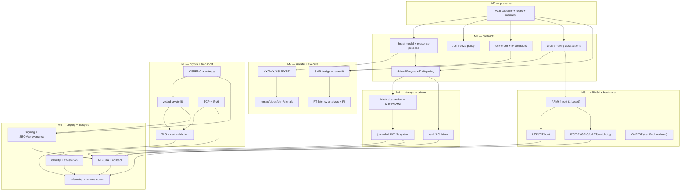

# NOVA OS — Long-Term Roadmap (post-v0.5 audit)

From the validated v0.5 baseline toward a secure,
production-oriented OS for edge/IoT infrastructure.
Planning document: it authorizes nothing by itself;
each milestone needs its own reviewed prompt and
evidence gates. No dates, no market sizes, no
performance promises — dependencies and proof
instead. Scale for qualitative judgments: LOW /
MEDIUM / HIGH with the meaning given inline.

## 1. Executive summary

v0.5 is a genuinely well-proven 32-bit x86 prototype
(23/23 tests, 7/7 corpora, 50 in-guest markers,
audited IF discipline, documented limits) confined
to one virtual machine. Production needs roughly
60 further capabilities (matrix: ~35 VERIFIED, ~55
ABSENT). The strategy: keep the monolith and the
proof culture, earn isolation incrementally, and
aim at ONE product — a deterministic, attested,
remotely managed edge node — where NOVA's evidence
habit is a differentiator instead of trying to
out-Linux Linux. Eight milestones (M0–M8) ordered
by dependency; the first code milestone is
contracts + security foundations, not features.

## 2. Current-state snapshot

- HEAD `0b5da64`: v0.5 Phase L (`59ea07b`) plus
  fbcon CLI console + CLI manual (authorized).
- Envelope: VirtualBox 7.2.6, 2 CPU / 1024 MB, NAT
  virtio-net, IDE disk. Tree clean, not pushed.
- Kernel: x86-32, BIOS stage1, PIC+PIT, BSP-only,
  strict-prio scheduler, 38 syscalls (INT 0x80),
  VFS big lock, UDP/ARP/DHCP/DNS, ramfs + FS
  readers, 128B-line shell, fbcon console.
- Proof assets: `tools/nova.py` (env/build/test/
  image/run-vbox/panic-test/bench/abi/dist),
  `ci/gate.py`, 14 host unit tests, 7 wire/FS/
  shell corpora, 50 serial markers, 80 ADRs.
- Debts on record: no SMP/NX/ASLR/IOMMU/TCP/IPv6/
  TLS/crypto/RNG/journaling/OTA/UEFI/ACPI/ARM64/
  USB/I2C/SPI/GPIO/WiFi/BT/mmap/pipes/shm/
  signals/POSIX/SMP attestation/SBOM/SECURITY.md.

## 3. Architectural principles (from ARCHITECTURE-STRATEGY)

Evidence over assertion; contracts before code;
narrow interfaces; keep the green green; boring
technology for trust; say what is missing. Any
milestone violating these fails review regardless
of code quality.

## 4. Target-product strategy

Fit = how much of v0.5 transfers; Risk = what kills
the direction; Edge = what NOVA could own.

A. General-purpose desktop OS. Fit LOW (no GUI
stack, no HID, no apps). Needs: display server,
GPU, USB, frameworks, i18n, a11y, app store.
Risks: 10,000-engineer treadmill; zero leverage.
Edge: none credible. VERDICT: reject.

B. General-purpose server OS. Fit MEDIUM (scheduler,
VFS, sockets transfer as patterns). Needs: SMP,
TCP/IPv6/TLS, journaling FS, NVMe, containers,
Linux-ABI compat (without it, no software runs).
Risks: ecosystem gravity — the moat is binaries,
not kernels. Edge: proof-carrying releases (real
but narrow). VERDICT: reject as primary; revisit
only via E.

C. Secure edge/IoT infrastructure OS. Fit HIGH:
headless, bounded workloads, NAT-style nets,
ramfs-seeded images, serial diagnostics, small
TCB — v0.5 already looks like a prototype of
this. Needs: ARM64, TCP/TLS, crypto/RNG, journaled
FS, OTA+rollback, attestation, fleet tooling.
Risks: hardware sprawl (board per port), radio
certification, long support tails. Edge: STRONG —
deterministic + attested + proof-gated releases
are exactly what edge buyers cannot get from a
general-purpose OS. VERDICT: PRIMARY target.

D. Deterministic real-time control OS. Fit HIGH:
strict-prio scheduler is an RT seed; tick-native
timebase; bounded everything. Needs: latency
analysis + guarantees, priority inheritance,
isolation of RT from best-effort, certification
evidence (the heavy part). Risks: certification
cost dwarfs engineering; inherits C's hardware
needs. Edge: measured timing where Linux needs
PREEMPT_RT bandaids. VERDICT: SECONDARY, pursued
as a workload profile inside C's product, not a
separate OS.

E. Minimal secure infrastructure appliance OS.
Fit HIGH (subset of C: fixed function, e.g.
gateway/filter). Needs: C minus fleet scale, plus
harder per-appliance assurance. Risks: small
market slices; custom work per appliance. Edge:
highest assurance per line of code. VERDICT:
first-product profile lives here (see §9 of the
audit brief: headless, verified image, bounded
resources, authenticated management, encrypted
channels, signed updates, recovery, diagnostics).

Decision: PRIMARY C, SECONDARY D-as-profile,
first product shaped as E. This genuinely fits
the kernel: v0.5's strengths (determinism,
boundedness, gates, tiny TCB) are C/D/E
strengths and A/B weaknesses.

## 5. Subsystem inventory (summary)

Full table: PRODUCTION-READINESS-MATRIX.md (~35
VERIFIED / ~55 ABSENT / 3 UNVERIFIED). Shape of
the gap by layer: platform 1/8 verified; execution
5/9; memory 5/9; syscalls/IPC 4/9; storage 4/9;
network 3/10; crypto/trust 0/6; drivers/IoT 3/11;
operations 2/13. The zeros (crypto/trust) and the
operations tail (OTA, fleet, SBOM) dominate the
critical path — see dependency graph.

## 6. Dependency graph

Read: an edge A → B means A must land (with gates)
before B starts. Parallel tracks are named where
contracts allow them.

Why the load-bearing edges exist: memory isolation
before sandboxing (a sandbox on X-only pages is
theater); abstractions before ARM64 (porting
scattered port I/O forks the tree); crypto+RNG
before anything authenticated (signatures without
entropy are forgeable); crash-consistency before
OTA (an update to a filesystem that cannot survive
a crash cannot survive an update); trust anchors
before OTA (verification needs something to verify
with); isolation+quotas before untrusted workloads
or one tenant starves the box. Parallel-safe once
contracts hold: TCP vs FS-journaling vs ARM board
bring-up proceed independently (different trees,
shared gates only).

## 7. Milestones (evidence-gated; scope + non-goals binding)

### M0 — v0.5 preservation and reproducibility
Objective: the reference never rots. Prereqs: none.
Scope: reproducible-build procedure doc, artifact
checksums at image time, SBOM seed, LICENSE audit
of dist/, manifest kept current. Non-goals: no
behavior change. Decisions first: x86-32 support
policy (proposed ADR). Tests: byte-identical
rebuilds on two hosts; full gate green. Exit: M0
checklist in RELEASE.md. Rollback: n/a (additive).

### M1 — Contracts and security foundations
Objective: write the rules before the code.
Prereqs: M0. Scope: threat model v1 (done: this
audit), ABI freeze policy + versioning, driver/
DMA policy, lock-order + IF contracts extended to
new code, failure/recovery model, disclosure +
patch process (create SECURITY.md). Non-goals: no
SMP, no new protocols. Decisions first: kernel-
architecture, ABI policy, driver-trust (proposed
ADRs). Tests: contract lints (table-driven, like
today's ADR-continuity lint). Exit: review-signed
contracts. Residual: contracts untested by code.

### M2 — Memory, isolation, execution
Objective: make exploitation hard and timing known.
Prereqs: M1 (policies). Scope: NX/W^X enablement +
tests; SMEP/SMAP/KPTI where HW allows; ASLR design
+ implementation; mmap/mprotect + COW + guards;
pipes/shm/signals; SMP design + full re-audit of
every BSP-only assumption; RT latency measurement
+ priority inheritance. Non-goals: no ARM64 yet;
no containers. Decisions first: mm-model,
smp-strategy, rt-contract (proposed ADRs). Tests:
permission-grid audit extended, mapping fuzz,
latency histograms under load, contention proofs
at 2+ CPUs. Exit: matrix memory rows VERIFIED.
Residual: side channels unmeasured (stated).

### M3 — Crypto and network transport
Objective: talk to the world without trusting it.
Prereqs: M1 (threat model), M2 (isolation for key
handling). Scope: vetted crypto lib integration
(adopt, never hand-roll) + CSPRNG + entropy policy
with failure behavior; TCP + IPv6; TLS + hostile-
first cert validation; per-process socket quotas;
adversarial network testing (floods, injections,
state-machine fuzz). Non-goals: no routing daemon,
no VPN product. Decisions first: crypto-source,
tcp-source (proposed ADRs). Tests: wycheproof-
class vectors, TLS corpus, exhaustion matrix.
Exit: a TLS session to a hostile peer, tested.
Residual: cert ecosystem trust (documented).

### M4 — Persistent storage and hardware interfaces
Objective: data survives crashes; devices abstract.
Prereqs: M1 (DMA policy), M2 (isolation). Scope:
block-device abstraction (ATA becomes backend 1);
AHCI then NVMe; ONE journaled RW filesystem chosen
by evidence (proposed ADR: fs-choice); embedded
flash strategy (FTL assumptions first); crash-
consistency model with power-loss tests. Non-goals:
no FS zoo; no encryption-at-rest yet (needs M3
crypto home + this milestone's consistency).
Tests: crash-injection rig, fsck-after-chaos,
torn-write proofs. Exit: pull-the-plug suite
green. Residual: media-specific failure modes.

### M5 — ARM64 and real hardware
Objective: leave the VM. Prereqs: M1 abstractions
(zero-delta x86), M4 drivers model. Scope: ONE
named dev board; ARM64 boot/exceptions/pagetables/
GIC/timers; UEFI or device-tree boot; I2C/SPI/
GPIO/UART/watchdog drivers; reproducible HW rig
(serial + power control + reflash). Non-goals: no
second board; no radios yet (certified modules
later). Decisions first: arm-board choice
(product, not taste). Tests: same gates on HW as
in VBox; board-specific suite. Exit: release
manifest names the board. Residual: board errata.

### M6 — Secure deployment and lifecycle
Objective: ship, update, recover, attest.
Prereqs: M3 (signatures/TLS), M4 (consistency),
M5 (board). Scope: signing pipeline + SBOM;
A/B OTA state machine with power-loss-safe
rollback; provisioning + identity; telemetry +
remote admin over mutual TLS; optional TPM/
attestation where HW has it. Non-goals: no fleet
UI (product software, separate). Tests: hostile
update server, corrupt packages, mid-write power
cuts, downgrade attacks, rollback drills. Exit:
ten hostile-update scenarios green. Residual:
physical attacks (stated).

### M7 — Edge-product readiness
Objective: prove the appliance, not the kernel.
Prereqs: M6. Scope: workload qualification on the
named board; 30-day soak with growth metrics
(heap/PMM/fd deltas — the metric v0.5 lacked);
full security review incl. exercised disclosure
process; HW compatibility matrix; upgrade AND
downgrade tests; support + vuln-response drills.
Non-goals: no new features (freeze). Exit: release
verdict A/B/C by the Phase-L rules. Residual: the
unknown unknowns a soak cannot name.

### M8 — Portability and ecosystem
Objective: other people's software runs. Prereqs:
stable ABI (M1) + isolation (M2). Scope: POSIX-
subset profile (named calls, proposed ADR:
posix-scope); packaging + service supervision;
SDK + cross toolchain + developer docs; isolation
model for workloads (proposed ADR:
isolation-model). Non-goals: full Linux compat;
desktop SDK. Tests: ported-app corpus (each app a
gate). Exit: three non-trivial third-party apps
green. Residual: compat treadmill (managed by
profile discipline).

## 8. Prioritized backlog (rubric: security-need ×
dependency-centrality × product-value, discounted by
risk × validation-cost × disruption; H/M/L are
judgments, not measurements)

Foundational blockers (nothing downstream starts
without them): arch/timer/irq abstractions (H/H/H);
ABI freeze policy (H/H/H); disclosure + patch
process (H/M/H); driver lifecycle + DMA policy
(H/H/H); SBOM + provenance seed (H/M/M).

First-product prerequisites: CSPRNG + entropy
(H/H/H); vetted crypto (H/H/H); TCP+IPv6 (H/H/H);
TLS hostile-first (H/M/H); journaled FS + crash
rig (H/H/H); A/B OTA + rollback (H/H/H); signing
pipeline (H/H/H); ARM64 single board (H/H/H);
identity + attestation-spine (M/H/H); NX/W^X/ASLR
(H/M/H); SMP re-audit (H/M/M); teardown/reaping
gaps closed (M/M/M).

Scalability (after first product): real NIC (M/M/M);
AHCI/NVMe (M/M/M); per-socket quotas (M/L/M);
 POSIX-subset (M/M/H); supervision + config (L/M/H);
fleet tooling (L/M/H); second board (L/L/M).

Advanced / optional: driver isolation (M/L/M, big
disruption); containers (L/L/M, needs isolation
first); FS encryption (M/L/M); formal proofs of
narrow properties (L/H/L — value only where a
certificate demands it).

Explicitly out (non-goals, do not backlog): desktop
stack, mobile stack, GPU compute, full Linux ABI,
FS zoo, routing daemons, VPN product, radio stacks
from scratch (certified modules only), 32-bit
deployment targets.

## 9. Acceptance-gate policy (every future phase)

Carry forward: baseline regression (23/23 + gates
never regress), unit + integration, fuzz + corpus
(never shrink a corpus to pass), malformed-input,
boundary/privilege, race/lock-order, preemption/
interrupt safety, exhaustion (cap-1/cap/cap+1/
recovery), ABI compat, determinism, soak with
growth metrics, perf-vs-prior (explain deltas),
reproducible builds, security review, threat-model
+ docs updated. Add per subsystem: power-loss/
crash recovery (storage/OTA), hostile-peer testing
(net/TLS), latency analysis (RT), HW-matrix runs
(drivers). A property is claimed only with the
methodology that can establish it; counts are
metrics, never proof.

## 10. Risks and open decisions

- Hardware sprawl eats the team (mitigate: ONE
  board per milestone, certified radio modules).
- Crypto/stack adoption inherits upstream risk
  (mitigate: license + maintenance + isolation
  review before adoption; pin + SBOM).
- SMP re-audit finds the design wanting (mitigate:
  M2 is design-first; keep BSP-only until then).
- Compat treadmill (mitigate: POSIX-subset profile,
  never blanket "POSIX").
- Proof-culture dilution as contributors grow
  (mitigate: gates are merge-blocking, contracts
  are review-blocking — process, not hope).
- Five decisions need human review before ANY
  implementation (audit report §12): kernel-arch
  retention, ARM-vs-x86-64 sequencing, TCP source,
  crypto source, FS choice. Plus POSIX scope and
  the first board. No code in these areas until
  the corresponding proposed ADR is ratified.

## 11. Amendment (Darwin-inspired architecture review)

Reconciliation with DARWIN-INSPIRED-ARCHITECTURE-
REVIEW.md (no fork: deltas only). (1) Kernel
direction refined: retain foundation, evolve
toward MODULAR monolith with ordered boundaries
(arch extraction → HAL → driver lifecycle →
service seams) — see review §4. (2) x86-64 named
first production arch, ARM64 next, x86-32
validation-only, RISC-V QEMU-only milestone
(review §6). (3) Driver work staged 1-2-3
(lifecycle → registry/matching → power/recovery;
review §7). (4) App-compat staged 1-5 (native →
POSIX-subset → Linux-ABI assessment → containers
→ VMs; review §10). (5) M1 exit gains arch/
timer/irq extraction + portability lint. (6) The
§8 backlog and §§7/9 gates are unchanged. All
still pending human ratification of the
proposals; this amendment authorizes no code.
